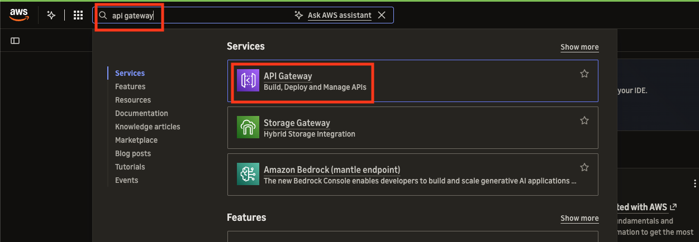
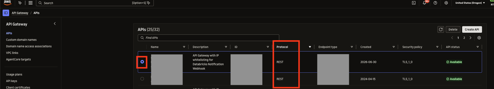
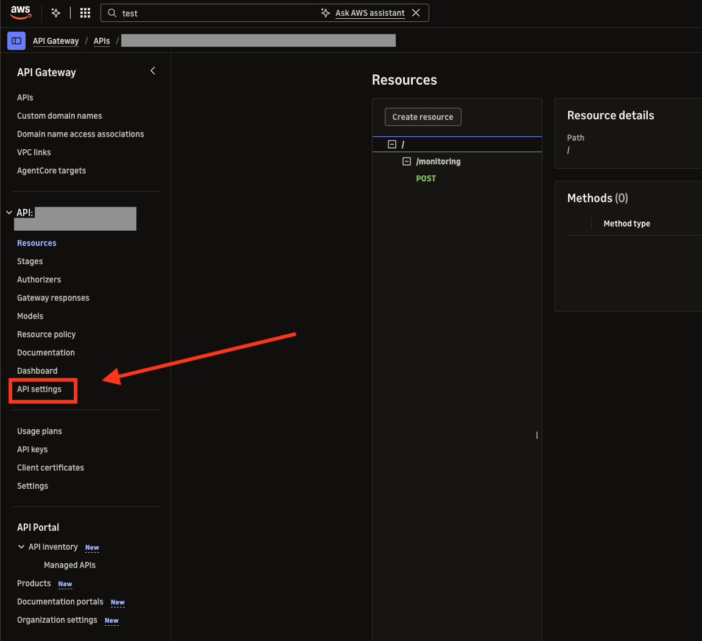
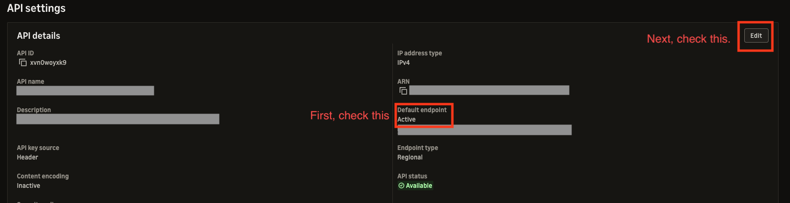
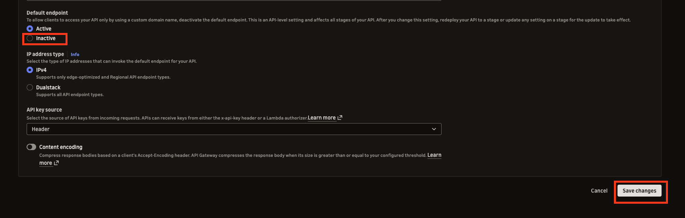
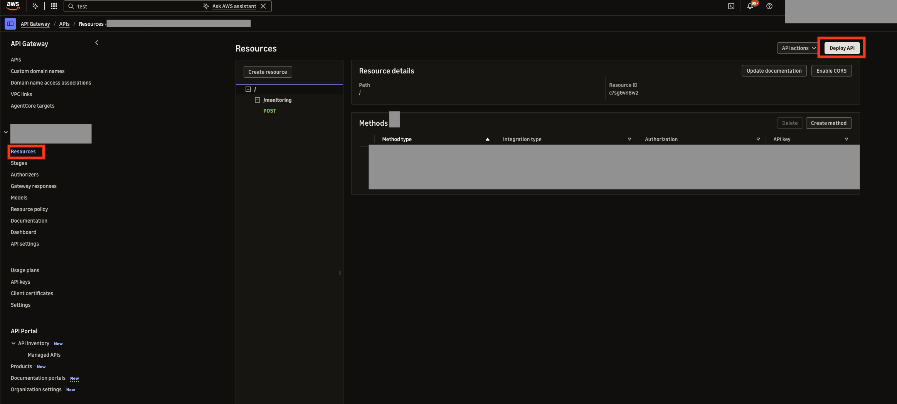
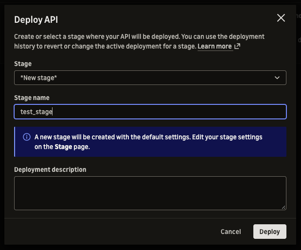

# AWS / API Gateway / API Gateway Default Endpoint Disabled

## Quick Info

| | |
|-|-|
| **Plugin Title** | API Gateway Default Endpoint Disabled |
| **Cloud** | AWS |
| **Category** | API Gateway |
| **Description** | Ensure default execute-api endpoint is disabled for your API Gateway. |
| **More Info** | By default, clients can invoke your API by using the execute-api endpoint that API Gateway generates for your API. To ensure that clients can access your API only by using a custom domain name, disable the default execute-api endpoint. |
| **AWS Link** | https://docs.aws.amazon.com/apigateway/latest/developerguide/rest-api-disable-default-endpoint.html |
| **Recommended Action** | Modify API Gateway to disable default execute-api endpoint. |

## Detailed Remediation Steps
1. Log in to the AWS Management Console.
2. On the console home page, enter "API Gateway" in the search bar at the top and select **API Gateway** from the results.   
3. In the main navigation pane, choose **APIs** and select and open the REST API (**Protocol**: REST) flagged in the scan results.   
4. The API opens on the **Resources** page. In the left navigation pane, under the API name, choose **API settings**.   
5. Under **API details**, check the value for **Default endpoint**. If it is set to **Active**, choose **Edit**.   
6. For **Default endpoint**, select **Inactive**, and then save the changes.   
7. In the left navigation pane, choose **Resources** and then choose **Deploy API**.   
8. For **Stage**, select the stage to deploy to (or choose **New stage** and enter a stage name) and then choose **Deploy**.   
9. Repeat steps 3 - 8 for every REST API flagged in the scan results, and in every Region where flagged APIs exist.
