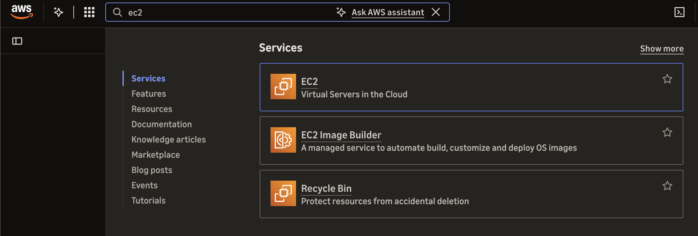
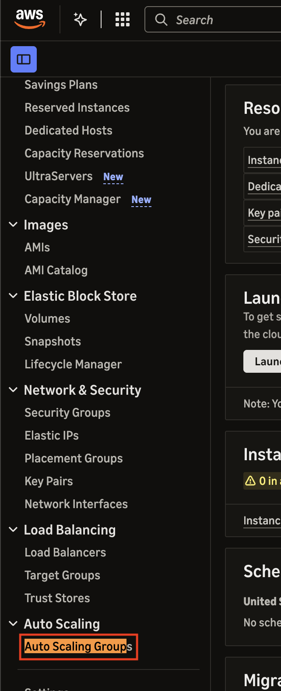
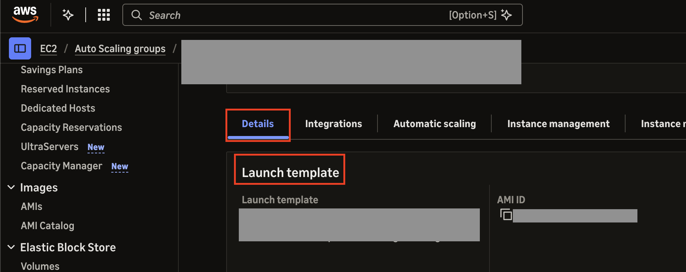
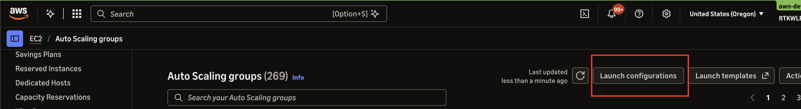
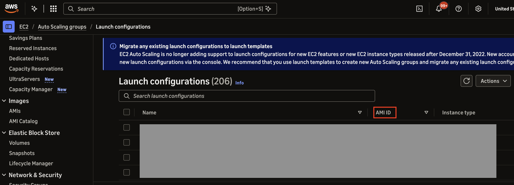
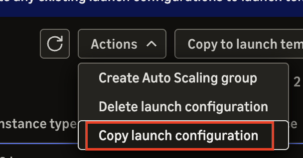
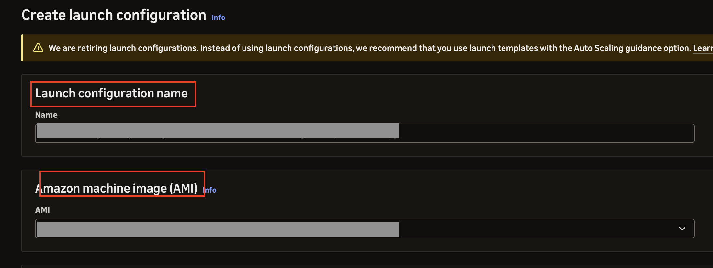
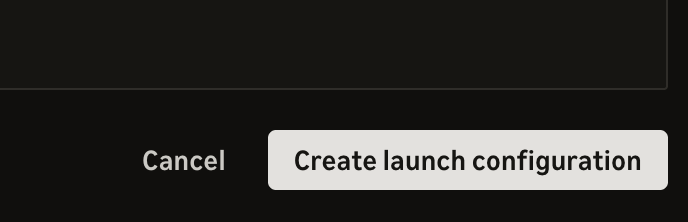
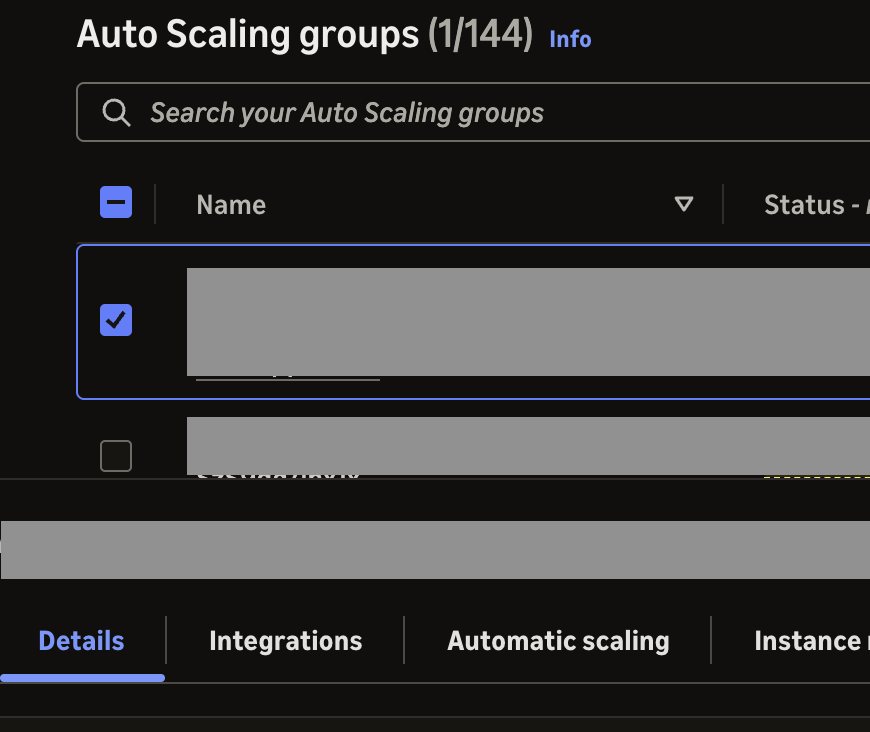

# AWS / AutoScaling / Web-Tier ASG Launch Configurations Approved AMIs

## Quick Info

| | |
|-|-|
| **Plugin Title** | Web-Tier ASG Launch Configurations Approved AMIs |
| **Cloud** | AWS |
| **Category** | AutoScaling |
| **Description** | Ensures that Web-Tier Auto Scaling Group Launch Configurations are using approved AMIs. |
| **More Info** | Web-Tier Auto Scaling Group Launch Configurations should use approved AMIs only to launch EC2 instances within the ASG |
| **AWS Link** | https://docs.aws.amazon.com/autoscaling/ec2/userguide/LaunchConfiguration.html |
| **Recommended Action** | Update Web-Tier ASG Launch Configuration to use approved AMIs only |

Note: This check applies only to Auto Scaling groups that have the configured Web-Tier tag key, and "approved" means the AMI IDs in your configured list of approved AMIs. Auto Scaling groups that use a launch template instead of a launch configuration cannot be evaluated by this check.

## Detailed Remediation Steps
1. Log in to the AWS Management Console.
2. On the console home page, enter "EC2" in the search bar at the top and select **EC2** from the results.   
3. In the left navigation pane, under **Auto Scaling**, choose **Auto Scaling Groups**.   
4. Select the Web-Tier Auto Scaling group flagged in the scan results. On the **Details** tab, under **Launch configuration**, note the name of the launch configuration used by the group. (If the group shows **Launch template** here instead, this plugin does not apply to it and no action is needed.)   
5. On the **Auto Scaling groups** page, choose **Launch configurations** at the top to open the Launch configurations page, then select the launch configuration noted in the previous step.   
6. Under the launch configuration details, check the value of **AMI ID** and compare it with your organization's list of approved AMIs. If the AMI is not on the approved list, continue with the steps below.   
7. With the launch configuration selected, choose **Actions** and then **Copy launch configuration**. (A launch configuration cannot be edited after it is created, so a new one must be created with the approved AMI.)   
8. On the **Create launch configuration** page, enter a new **Name** for the launch configuration, and under **Amazon machine image (AMI)**, choose **Edit AMI** and select an approved AMI.   
9. Scroll down to the end of the page and choose **Create launch configuration**.   
10. In the left navigation pane, under **Auto Scaling**, choose **Auto Scaling Groups** and select the Web-Tier Auto Scaling group flagged in the scan results.   
11. On the **Details** tab, under **Launch configuration**, choose **Edit**, then for **Launch configuration**, select the new launch configuration created in step 9, and choose **Update** to save the changes.
12. On the **Details** tab, confirm that the **Launch configuration** now shows the new launch configuration, and that the **AMI ID** of that launch configuration is an approved AMI.
13. Repeat steps 4 - 12 for the other Web-Tier Auto Scaling groups flagged in the scan results.

Note: The new launch configuration is only used for instances launched after the change. Instances that are already running continue to use the previous AMI until they are replaced. To replace them, start an instance refresh from the **Instance refresh** tab of the Auto Scaling group, or terminate the instances so that the group launches new ones.
